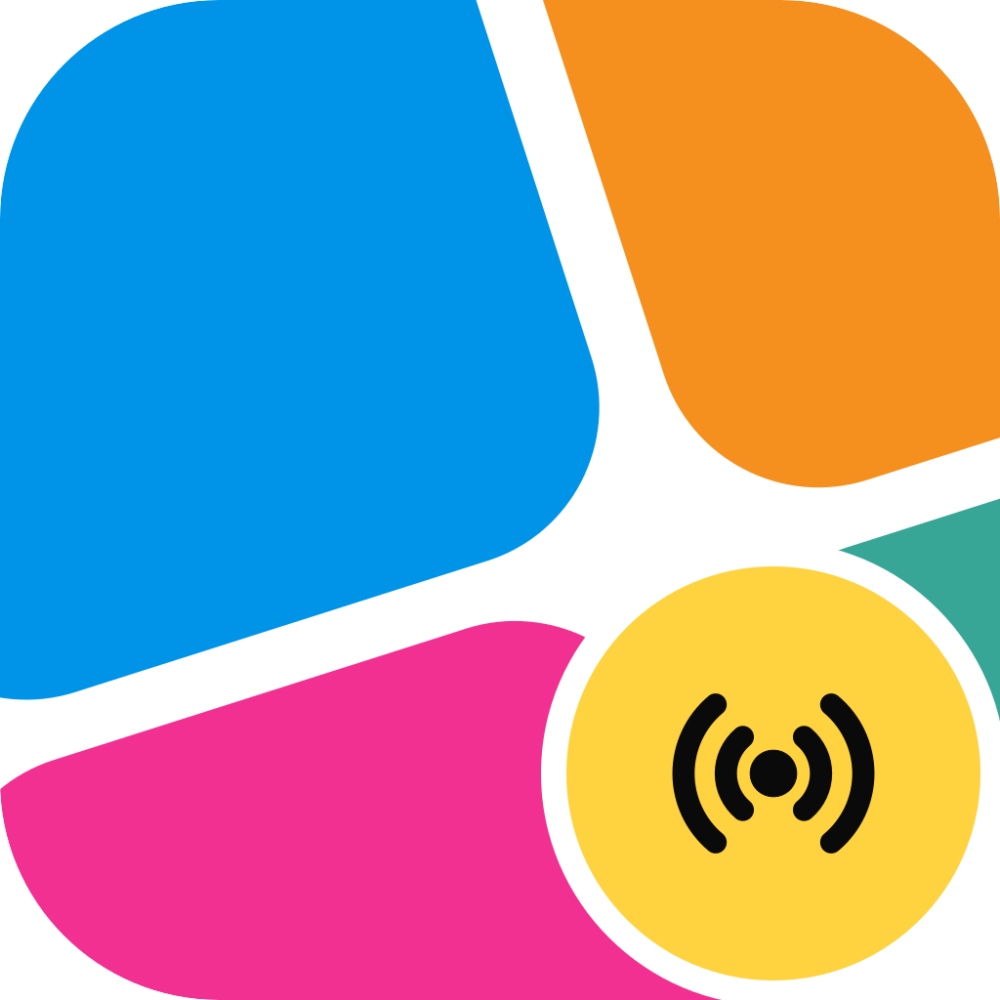
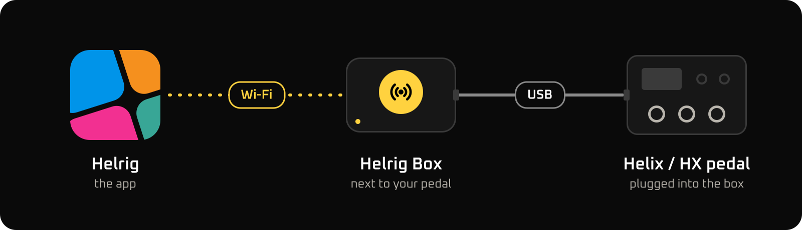

  

<h1 align="center">Helrig Box</h1>

A small box that puts your Helix or HX pedal on your Wi-Fi, so <a href="https://helrig.com">Helrig</a> can edit it without a cable to your computer.

The pedal plugs into the box by USB, the box joins your Wi-Fi, and Helrig finds it and edits the pedal as it would over a cable. The box only carries
the pedal's USB traffic; it does not read or change your presets itself.

Tried so far with a **Helix LT** and an **HX Stomp**. Connecting to a pedal in Helrig needs Helrig Connect or Helrig Pro.

## Get one running

1. **Get the parts.** A [Waveshare ESP32-P4-NANO](https://www.waveshare.com/esp32-p4-nano.htm?sku=29026) board ([wiki](https://www.waveshare.com/wiki/ESP32-P4-NANO)), a USB-C cable that carries data, a USB-C power source,
   and the USB cable you use to connect your pedal to a computer. [Full list](docs/flashing.md#what-you-need).
2. **Install the firmware** from your browser (desktop Chrome or Edge), with nothing to install: **[box.helrig.com/flash](https://box.helrig.com/flash)**.
   It takes about 2 minutes. [Step by step, drivers and troubleshooting](docs/flashing.md).
3. **Set it up.** Join the box's own Wi-Fi network (**Helrig Box** plus six characters) on your phone, open `http://192.168.4.1`, and enter your home Wi-Fi.
   [Setup and factory reset](docs/setup.md).
4. **Use it.** Plug your pedal into the box's **USB-A** port, open Helrig, and pick the box in the device menu.

The Wi-Fi is 2.4 GHz only. The box has no password of its own yet, so use it on a network you trust.

## Questions and problems

Check [Troubleshooting](docs/flashing.md#troubleshooting) first. If that does not help, [open an issue](https://github.com/maveric1977/helrig-box/issues) and say which
pedal, which computer and browser, and what the page or the box did.

## For developers

The firmware is [ToneRelay](https://github.com/mpeskett88/ToneRelay), an open-source Wi-Fi relay for Helix pedals by Mark Peskett, built with a small
Helrig Box profile (its names, setup page and defaults). This repository holds that profile, the web flasher and the docs.
[How it fits together](docs/dev/architecture.md) · [Build from source](docs/dev/build.md) · [Releasing](docs/dev/releasing.md) · [What has been measured](docs/dev/measurements.md)

## Licence

The code and docs are MIT ([LICENSE](LICENSE)). The Helrig name, the Helrig Box logo and the icon are Helrig's and are not covered by it; see
[NOTICE.md](NOTICE.md), which also lists the other software used. Helrig and the Helrig Box are not affiliated with Line 6 or Yamaha Guitar Group.
