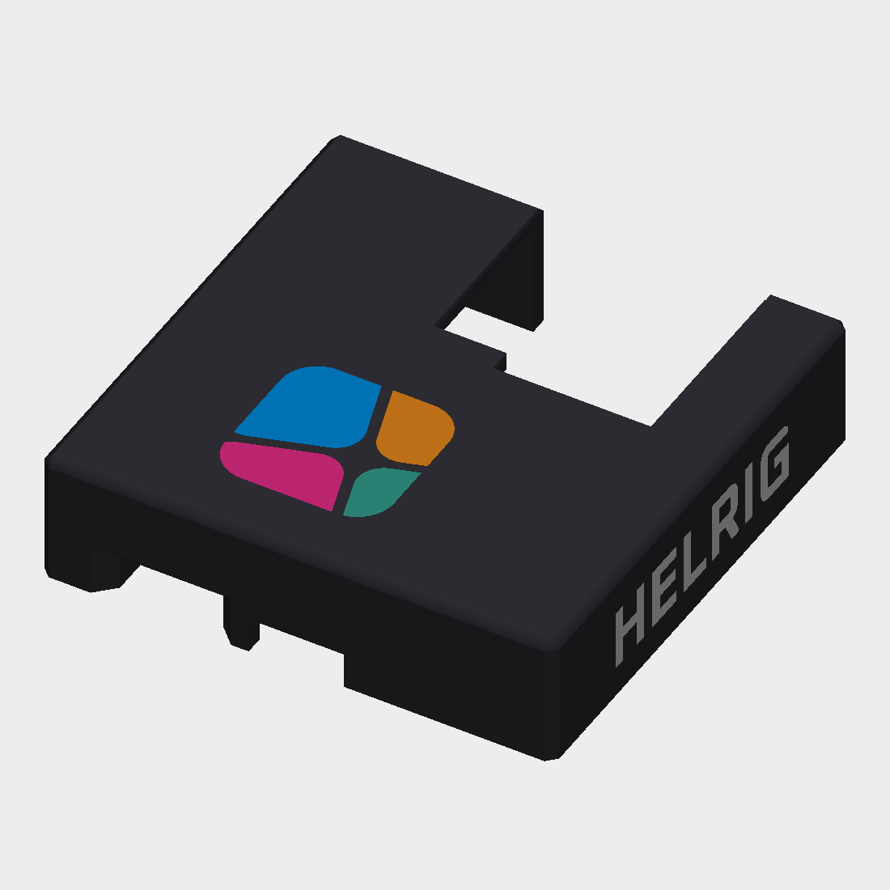
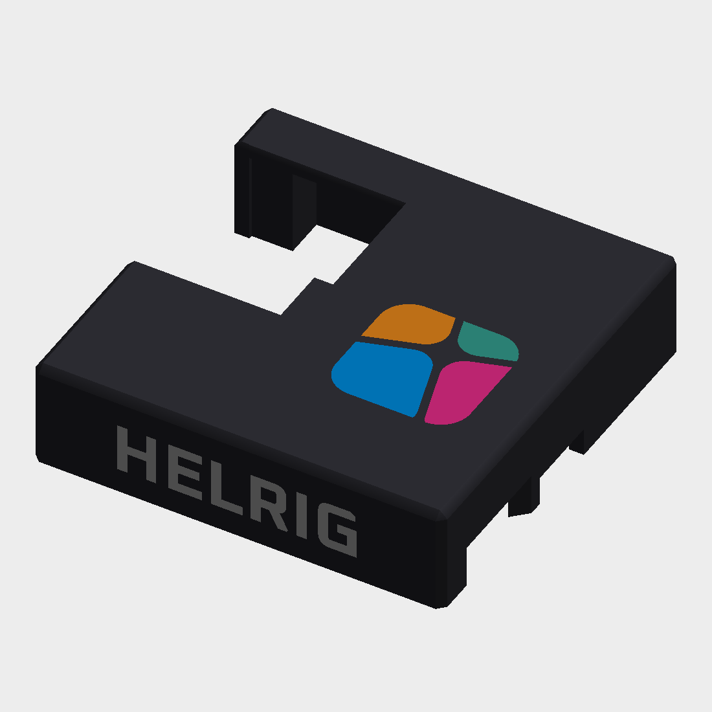
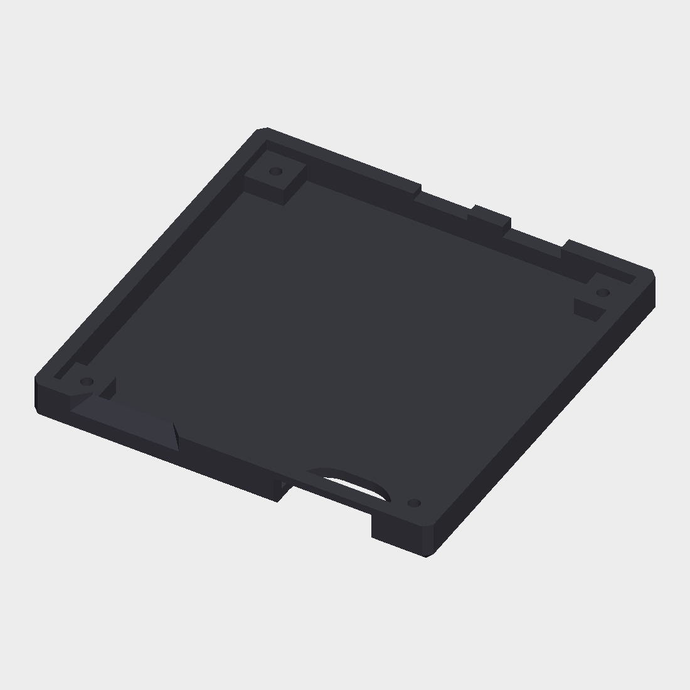

# Multi-colour variant

The branding is printed in colour: the four symbol tiles in the brand colours and the wordmark in white, on a dark lid. The recesses in the lid are filled by separate inlay parts that fit them exactly. Set up for a Bambu Lab A1 with AMS lite (4 filaments); other multi-material printers work the same way.

Uses M2×7 screws.

## Files

| File | Notes |
|---|---|
| [`stl/helrig-box_lid.stl`](stl/helrig-box_lid.stl) | the lid with the branding recesses, rotated top face down for printing |
| [`stl/helrig-box_inlay-blue.stl`](stl/helrig-box_inlay-blue.stl) | symbol tile |
| [`stl/helrig-box_inlay-orange.stl`](stl/helrig-box_inlay-orange.stl) | symbol tile |
| [`stl/helrig-box_inlay-pink.stl`](stl/helrig-box_inlay-pink.stl) | symbol tile |
| [`stl/helrig-box_inlay-teal.stl`](stl/helrig-box_inlay-teal.stl) | symbol tile |
| [`stl/helrig-box_inlay-wordmark.stl`](stl/helrig-box_inlay-wordmark.stl) | HELRIG on the left and right walls (12 pieces) |
| [`stl/helrig-box_bottom.stl`](stl/helrig-box_bottom.stl) | the original bottom, floor down, no branding |

The lid and the five inlays share one coordinate system and must stay together. The bottom is a separate print.

The lid top is closed except for one window at the back for the Ethernet jack. The front wall has the USB openings.

## Previews

The previews show the lid as designed (top face up), in dark filament with the inlays in colour.

| Lid, top | Lid, left wall |
|---|---|
|  |  |

| Bottom, top | Bottom, angled |
|---|---|
|  |  |

## Orientation

The lid is already rotated: top face on the bed, open side up, no supports needed. Do not rotate it.

The inlays are required in this orientation. Without them the symbol recess would be a 0.6 mm roof over nothing (263 mm² unsupported). Print them in any filament, even the lid colour, but do not drop them.

## Slicer settings (Bambu Studio)

1. **Printer and process:** Bambu Lab A1 0.4 nozzle, 0.20 mm Standard, PLA.
2. **Import:** File > Import, select the lid and the five inlay STLs at once. When asked, choose "Load as a single object with multiple parts". Do not auto-orient or rotate.
3. **Assign filaments per part** (Objects list > part > Filament), for the AMS lite's 4 slots:

   | Slot | Part | Colour |
   |---|---|---|
   | 1 | lid | black (or any dark colour) |
   | 2 | `helrig-box_inlay-wordmark` | white |
   | 3 | blue and teal tiles | blue |
   | 4 | orange and pink tiles | orange |

   This pairs the tiles diagonally. The full look (dark lid, white wordmark, four tile colours) needs 6 filaments, and the AMS lite holds 4. On a printer with 6 or more filament slots, give every part its own colour.
4. **Settings:** wall loops 3 or more, top/bottom 5 layers, prime tower on. The inlays are 0.6 mm = 3 layers at 0.2 mm, so keep 0.2 mm layers.
5. **Bottom:** print it separately, flat on its floor, in black. About 350 mm² of small overhangs and chamfers; try without supports first.

## Notes

- The prime tower and purging add noticeable time and waste with 4 or more filaments.
- The wordmark sits on the vertical walls, so it needs a real multi-material print; a layer-based colour change cannot do it.
- The files are checked for orientation, volumes and clearances: the lid plus the five inlays add up to the original lid volume exactly. They have not been sliced or printed yet. Check the first layers in the preview, and print a test first.

## Licence

See [`../ATTRIBUTION.md`](../ATTRIBUTION.md). CC BY 4.0, based on the work of MartinFaustMayer.
