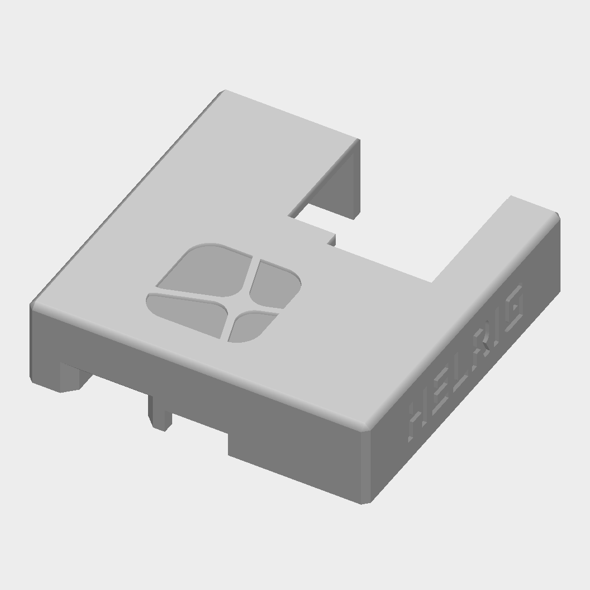
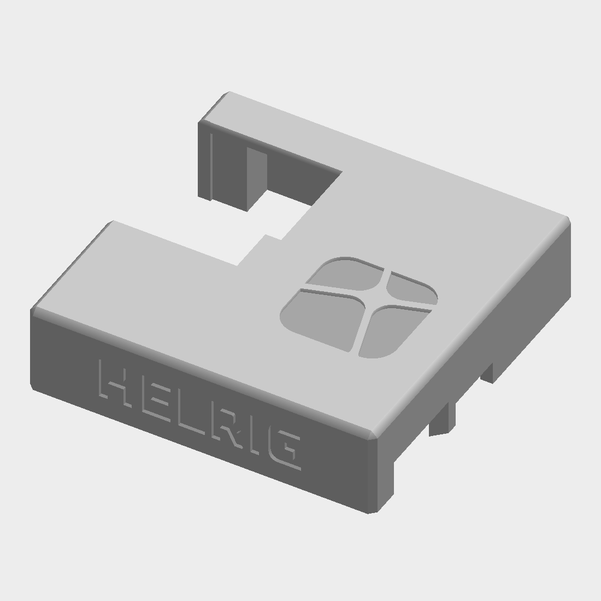
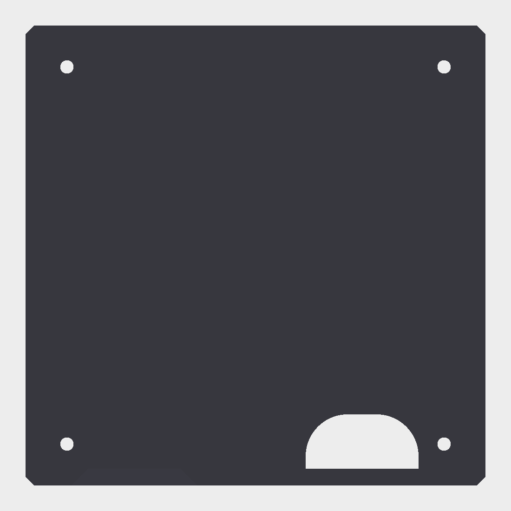

# Single-colour variant

One filament, branding painted by hand. Works on any FDM printer; the files and settings here are set up for a Bambu Lab A1 mini.

Uses M2×7 screws.

## Files

| File | Notes |
|---|---|
| [`stl/helrig-box_lid.stl`](stl/helrig-box_lid.stl) | 55 × 55 × 14.2 mm, top face up, one body, watertight |
| [`stl/helrig-box_bottom.stl`](stl/helrig-box_bottom.stl) | 55 × 55 × 5.6 mm, floor down; the original part, no branding |

The lid top is closed except for one window at the back for the Ethernet jack. The front wall has the USB openings.

## Previews

| Lid, top | Lid, left wall |
|---|---|
|  |  |

| Bottom, top | Bottom, angled | Paint guide |
|---|---|---|
|  |  |  |

The renders show the lid in white and the bottom in black. The paint guide shows where each brand colour goes.

## Orientation

Print both parts as they are. Do not flip the lid.

The branding is a 0.6 mm recess. Flipped onto the bed, the symbol recess would be a 0.6 mm roof over nothing. Top face up, the recesses are open pockets in the last layers, which print cleanly and hold paint.

## Slicer settings (Bambu Studio)

1. **Printer and process:** Bambu Lab A1 mini 0.4 nozzle, 0.16 mm Optimal or 0.20 mm Standard. Filament: PLA.
2. **Lid supports: on.** The 2 mm top plate (about 1980 mm²) hangs 12.2 mm above the bed, so it needs supports underneath, inside the lid. Use Tree (auto) or Normal, "On build plate only", with a small top Z distance (0.15–0.2 mm). A few small tabs inside also get support. The support marks end up inside the lid, not on the branded surface.
3. **Wall loops:** 3 or more. The side wordmark is only 0.6 mm deep in a 2 mm wall.
4. **Bottom:** sits flat on its floor, no rotation. About 350 mm² of small overhangs and chamfers; try without supports first and check the preview.

Other slicers: the same settings apply. The only critical points are the orientation and the supports under the lid's top plate.

## Painting

Colour suggestion: white lid, black bottom. On a dark lid, paint the wordmark white instead.

- Use a fine-tip acrylic paint pen or a small brush. Paint into the recesses, then wipe or lightly sand the flat surface to remove overspill. The 0.6 mm edge keeps lines crisp.
- **Wordmark (both side walls):** black on a white lid, white on a dark lid.
- **Symbol tiles, brand colours** (as in the paint guide):

  | Position | Colour | Hex |
  |---|---|---|
  | top-left | blue | `#0094E9` |
  | top-right | orange | `#F5901E` |
  | bottom-left | pink | `#F23091` |
  | bottom-right | teal | `#38A696` |

- Pens: a 0.7–1 mm opaque paint marker fits the recesses (for example Posca PC-1MR, Pen-Touch extra fine, or Uni Paint PX-20). On white PLA the colours go on in one or two thin coats. On dark PLA, paint the tile recesses white first.
- Seal with a matte clear coat if the case will be handled a lot.

## Status

The files are checked for watertightness, orientation, volumes and clearances. They have not been sliced or printed yet. Check the preview in your slicer, and print a test first.

## Licence

See [`../ATTRIBUTION.md`](../ATTRIBUTION.md). CC BY 4.0, based on the work of MartinFaustMayer.
